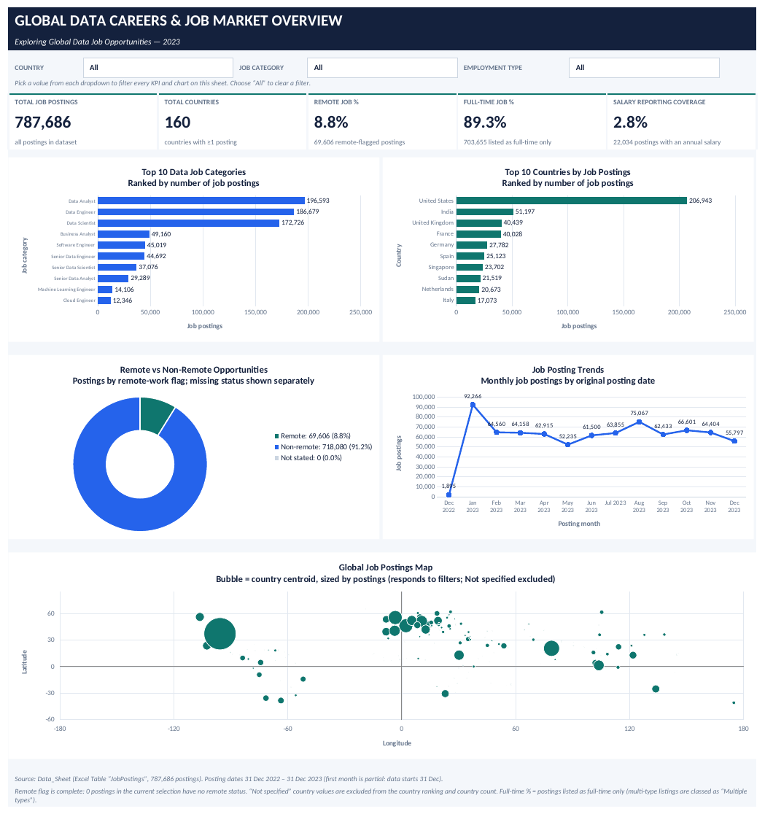
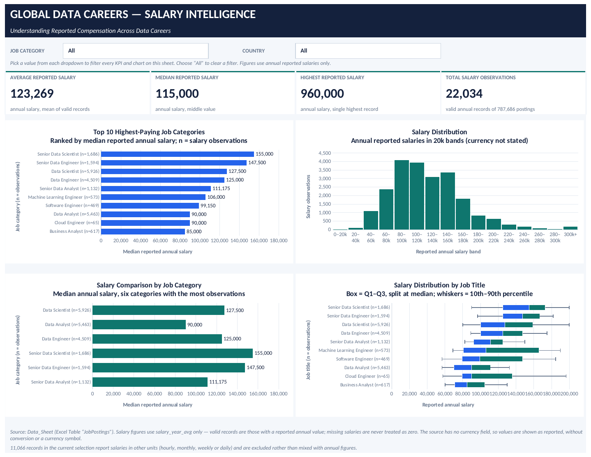

# Global Data Careers & Salary Intelligence — Job Market Analytics 2023

An interactive, two-page Excel dashboard that analyzes **787,686 global data-job postings from 2023**: where the jobs are, which roles are most in demand, how much work is remote or full-time, and what the (limited) reported salary data says about compensation.

Built entirely in Microsoft Excel with an Excel Table, formulas and native charts — no macros, no external connections.

---

## Dashboard Preview

### Page 1 — Job Market Overview


### Page 2 — Salary Intelligence


> Screenshots were rendered with LibreOffice from the delivered workbook; fonts and spacing may differ slightly in Microsoft Excel.

---

## Key Findings

All figures below are calculated from the dataset (no filters applied).

**Job market**
- **787,686** job postings across **160** countries (the "Not specified" placeholder is excluded from the country count).
- The **United States** leads with **206,943** postings (about 26%), followed by **India** (51,197) and the **United Kingdom** (40,439).
- Most demanded categories: **Data Analyst** (196,593), **Data Engineer** (186,679) and **Data Scientist** (172,726).
- Only **8.8%** of postings are flagged as remote (69,606); **89.3%** are listed as full-time only.
- January 2023 was the busiest month (92,266 postings); monthly volume then stayed roughly between 52k and 75k.

**Salary (reported annual salaries only)**
- Only **22,034 postings (2.8%)** report a usable annual salary, so salary findings describe a small subset of the market.
- Median reported annual salary: **115,000**; average: **123,269**; highest: **960,000**.
- Highest median pay: **Senior Data Scientist (155,000, n = 1,686)** and **Senior Data Engineer (147,500, n = 1,594)**.
- Lowest median among the ten categories: **Business Analyst (85,000, n = 617)**.

---

## Workbook Structure

| Sheet | Purpose |
|---|---|
| `Dashboard_Overview` | Job market KPIs, five charts, three filters |
| `Salary_Analysis` | Salary KPIs, four charts, two filters |
| `Data_Sheet` (hidden) | The dataset columns used by the dashboards, as an Excel Table named `JobPostings` |

### Page 1 — Job Market Overview
- **KPIs:** Total Job Postings, Total Countries, Remote Job %, Full-Time Job %, Salary Reporting Coverage.
- **Charts:** Top 10 Job Categories, Top 10 Countries, Remote vs Non-Remote (donut), Monthly Job Posting Trend, Global Job Postings Map.
- **Filters (dropdowns):** Country, Job Category, Employment Type.

### Page 2 — Salary Intelligence
- **KPIs:** Average, Median and Highest Reported Salary; Total Salary Observations.
- **Charts:** Top 10 Highest-Paying Job Categories (median, with n), Salary Distribution (histogram), Salary Comparison by Job Category, Salary Distribution by Job Title (box plot).
- **Filters (dropdowns):** Job Category, Country.

Every KPI and chart is formula-driven and recalculates when a filter changes. Choose **All** to clear a filter.

---

## Data Handling & Methodology

- **All rows kept, unused columns dropped.** All 787,686 postings are included; no rows were removed (the source has no duplicate `job_id` values or duplicate rows). To keep the workbook small enough for GitHub (about 21 MB), `Data_Sheet` holds only the 8 original columns the dashboards use: `job_title_short`, `job_schedule_type`, `job_work_from_home`, `job_posted_date`, `job_country`, `salary_rate`, `salary_year_avg`, `salary_hour_avg`. Text-heavy and identifier columns (`job_id`, `company_id`, `job_title`, `job_location`, `job_via`, `search_location`, `job_no_degree_mention`, `job_health_insurance`) were left out. Values in the kept columns match the original file exactly, except that `job_posted_date` is stored as a date (time of day removed), which doesn't affect any monthly figure.
- **One added column:** `employment_type`, a cleaned version of `job_schedule_type`. The source mixes multi-value entries (e.g., "Full-time and Part-time") and some non-English values; these are grouped into Full-time, Contractor, Part-time, Internship, Temp work, Multiple types, Other and Not specified.
- **Salaries use `salary_year_avg` only.** The dataset has no currency field, so values are shown **as reported** — no currency symbol, no conversion. Hourly records (10,665) and records with monthly, weekly or daily rates or no usable value (401) are excluded rather than mixed with annual figures. Missing salaries are never treated as zero.
- **Rankings use the median** and show the number of observations (n).
- **Salary coverage** = postings with a usable annual salary ÷ all postings (2.80%).
- **Remote status** is complete in this dataset (no missing values). The donut still has a separate "Not stated" slice so missing data would never be counted as non-remote.
- **Box plot:** box = 25th–75th percentile, split at the median; whiskers = 10th–90th percentile. "Job title" refers to the 10 standardized titles in `job_title_short`.

---

## Limitations & Data Caveats

- **Sudan anomaly.** Sudan shows 21,519 postings (8th place in the country ranking), but none of those postings has a Sudan location. Most carry US locations (e.g., Texas, New Mexico, Colorado), and all were collected under a "Sudan" search location. This looks like a collection artifact, not real Sudanese demand. It is left in this workbook for transparency; interpret country rankings and the map with that in mind.
- **Thin salary data.** Only 2.8% of postings report an annual salary; some category/country combinations have very few observations. Always read medians alongside n.
- **Outliers.** Seven annual salaries exceed 500,000 (maximum 960,000). They were kept as reported and mainly affect the average and highest-salary KPIs.
- **Partial first month.** The data starts on 31 Dec 2022, so the first point of the trend line is a single day.
- **Map.** The Global Job Postings Map is a bubble map (country centroids sized by postings) without a base map; centroid coordinates are approximate.
- **Filters are dropdowns, not slicers/PivotTables**, because they could not be generated reliably outside Excel. Each change recalculates formulas over ~787k rows, which can take a few seconds.
- **Reduced dataset.** This workbook is a lighter version of the source data (see Data Handling). The full raw file is not included in this repository.
- **Tested in LibreOffice**; open in Excel and confirm everything renders as expected.

---

## How to Use

1. Open `Global_Data_Careers_Salary_Intelligence.xlsx` in Microsoft Excel.
2. Use the dropdown cells at the top of each dashboard to filter KPIs and charts.
3. Hidden columns to the right of each dashboard hold the calculation helpers — please don't delete them.

---

## Repository Contents

```
├── README.md
├── Global_Data_Careers_Salary_Intelligence.xlsx
└── asset/
    ├── dashboard_overview.png
    └── salary_analysis.png
```

## Skills Demonstrated

Data cleaning and validation · Excel Tables and structured references · dynamic KPI formulas (COUNTIFS, AVERAGEIFS, MEDIAN/PERCENTILE arrays) · dashboard design and storytelling · documenting data limitations transparently.
